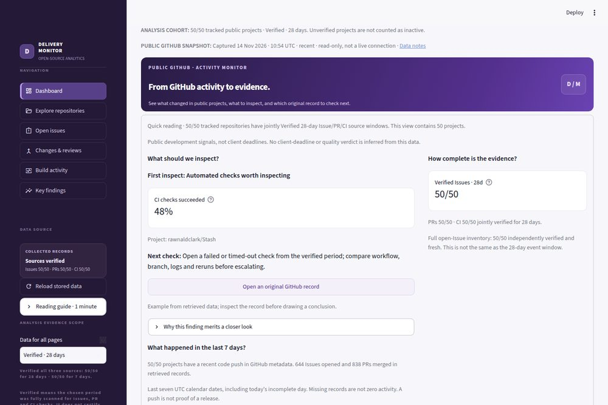
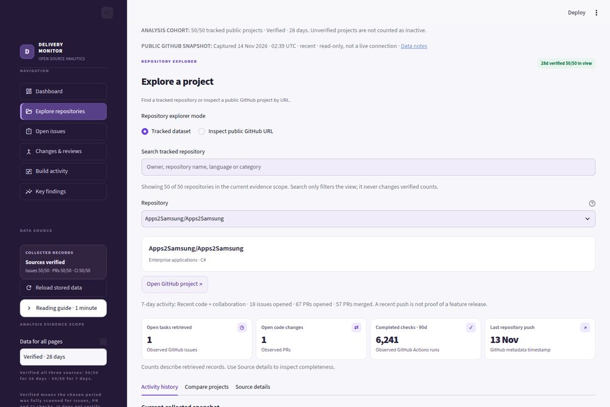
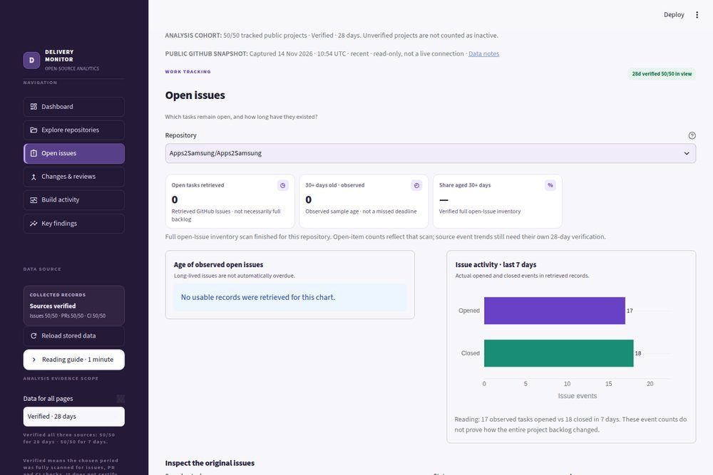
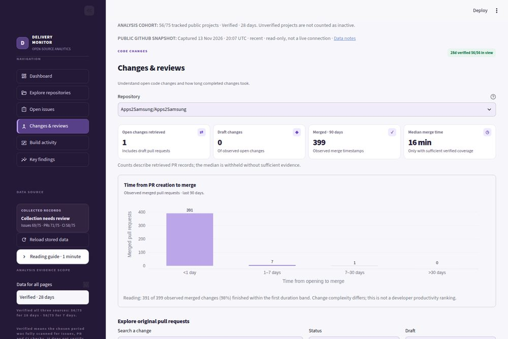
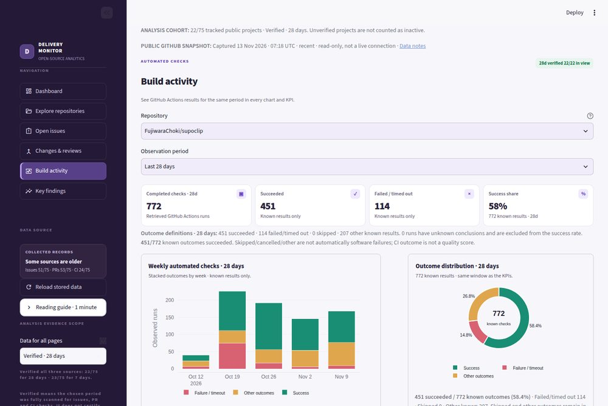
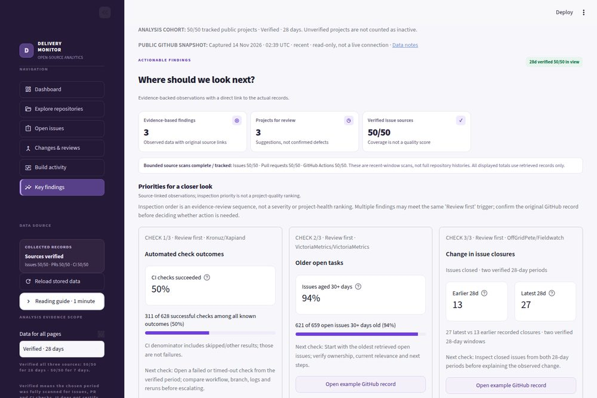
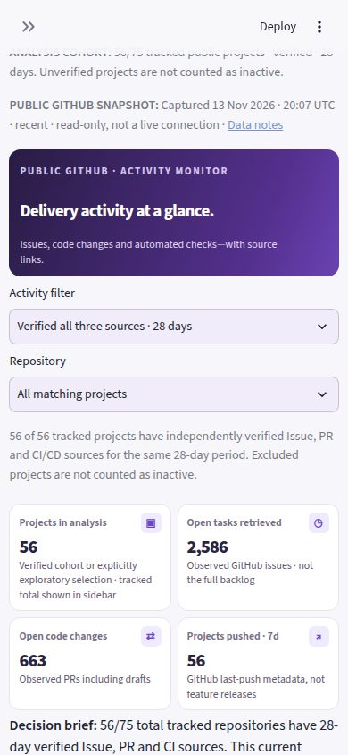

# Project Delivery Monitor — Open-Source Analytics

An evidence-first, read-only analytics dashboard that helps nontechnical reviewers understand observable issue, pull request, and GitHub Actions activity across an **audited, non-representative sample** of public GitHub repositories. Built with Python, Streamlit, Pandas, Plotly and SQLAlchemy; **SQLite** is the default collector database, with **PostgreSQL optional**. The public demo reads a compressed snapshot without needing a live SQL server. No React, FastAPI, chatbot, generative AI, or paid AI APIs.

> **Curated-cohort change (14 November 2026):** An independent 28-day Issues/PR/CI audit found 56 jointly Verified repositories in the previous 75-project sample. Exactly 50 audited identities are pinned in [the reviewed manifest](data/curated_50_manifest.json) now published on `main`, with 25 original source reports archived. This dated selection is not a promise that 50/50 remain fresh indefinitely. GitHub Actions refresh and desktop/mobile UI screenshot tests exist. GitHub Actions collection is configured to run every four hours, but individual runs can be delayed or fail; never mistake a stored snapshot for real-time data. Hosted Streamlit Cloud deployment and managed PostgreSQL are separate, optional steps and are **not** claimed verified here. All figures are obtained from public GitHub records.

## Reviewer quick start — what the evidence can and cannot answer

**Purpose:** Identify public GitHub activity that merits source-level inspection.
The name **Project Delivery Monitor** does **not** mean that this dataset
contains client deadlines, milestone completion, budgets or SLAs.

1. Open **Dashboard** for a 7-day activity summary and a direct GitHub evidence link.
2. Read **Key findings** for inspectable, bounded next steps, not defect verdicts.
3. Use **Explore repositories → Compare projects** for verified 7/28-day metrics;
   inspect an external public GitHub URL separately from the fixed cohort.

**Metrics policy:** The main PR merge-time and CI finding windows are 28 days
when independently verified. A 90-day view is optional and can be withheld
when the source does not cover all 90 days. CI success share counts successes
over *all known completed outcomes*, including skipped/cancelled/neutral in
the denominator; those outcomes are not classified as failures. The 30+ day
Issue-age threshold describes age, not the event-history window.

## Start here — 60-second reviewer tour

**Business question:** Which public software projects show observable work,
what is the exact source confidence, and which original GitHub record should
someone inspect before reaching a conclusion? This is **not** a client-delivery
tracker, SLA monitor or employee-productivity ranking.

| What the reviewer sees | What they can check |
| --- | --- |
| **50 curated public GitHub repositories** | Six interactive views for source-specific Issues, PRs and Actions runs |
| **Verified vs exploratory scopes** | A 28-day verified cohort only includes repositories whose three source scans cover that period; incomplete sources remain discoverable |
| **Evidence-based findings** | A concrete count/denominator, next review step, and **direct original GitHub record** where retrieved; otherwise an explicitly labelled source listing |
| **Reproducible engineering** | Read-only SQL snapshot integrity checks, browser screenshots, and measured reduction from 376 to 6 database SELECT queries for 75 repos (not a claimed browser speedup) |

**Reader guide:** [60-second plain-language walkthrough](docs/REVIEWER_QUICK_GUIDE.md).
For implementation and caveats, use the technical sections below.

**Show the work:** [one-page case study](docs/PORTFOLIO_CARD.md) ·
[3 real GitHub record walkthroughs](docs/EVIDENCE_CASE_STUDIES.md) ·
[full technical evidence](docs/PORTFOLIO_CASE_STUDY.md) ·
[latest browser capture workflow](https://github.com/Granbe1l/beta-test/actions/workflows/ui-screenshots.yml) ·
[actual SQL optimization tests](https://github.com/Granbe1l/beta-test/pull/15) ·
[CV-safe wording](docs/CV_EVIDENCE.md).

**Live demo:** **not yet publicly verified**. Use the
[deployment and verification guide](docs/PUBLIC_DEPLOYMENT.md).
Do not claim recruiters can open a hosted app before its public verification passes.

## Actual dashboard screenshots · verified browser capture

The images below are **scaled copies of real Playwright screenshots** produced
from the checked-in public GitHub dataset, not UI mockups. They demonstrate
the six interface pages; they do **not** prove public Streamlit hosting,
complete API history or an actual recruiter usability session. The latest
capture metadata and source commit are in the
[gallery provenance manifest](docs/gallery/manifest.json).

| Dashboard | Explore repositories | Issues & backlog |
| :---: | :---: | :---: |
|  |  |  |
| Pull requests | CI/CD | Evidence-backed findings |
|  |  |  |



The permanent gallery updates from a **successful main-branch browser audit
when UI/capture code changes**, not from every four-hour data refresh.
Original full-resolution screenshots and all six mobile-page checks remain
available as time-limited [GitHub Actions screenshot artifacts](https://github.com/Granbe1l/beta-test/actions/workflows/ui-screenshots.yml).
See [gallery limitations and provenance](docs/gallery/README.md).

## Reviewer usability and performance evidence

The P1 Dashboard uses a single brief **What happened → Why inspect →
Next action → source record**, with optional deeper charts. Browser-captured
full-page mobile height most recently decreased from **5,067 to 3,180 pixels**
at 390px width (**37% shorter**) after retaining the main chart and source
action while moving three supporting evidence cards behind an expander.
The earlier baseline reduction (**7,227 to 5,108 pixels**) is historical;
the prior desktop capture comparison was **4,298 to 2,680 pixels**.
These are **measured layout lengths**, not website speed or a human comprehension score.
[Mobile change and real-browser validation](https://github.com/Granbe1l/beta-test/pull/53).

See [P2 source scope, accessibility, API throttling and local render
measurement](docs/REVIEWER_P2_EVIDENCE.md). A real human usability study
and public deployment verification are intentionally separate.

## What SQL is used for

This project **uses SQLite in the collector and for source-level checkpoints**, with optional PostgreSQL support. `src/analytics/read.py` retrieves tables through SQLAlchemy in **batched SELECTs** (measured on a restored real snapshot), while `scripts/sql_insights.py` runs **actual read-only SQL** with grouped CTEs and source-coverage safeguards. The default public Streamlit view reads a committed, compressed JSON snapshot and uses Python/Pandas for presentation; it does not run remote SQL on each visitor's request. See [schema and SQL usage](docs/SQL_DATABASE_USAGE.md) and [the measured performance gate](https://github.com/Granbe1l/beta-test/pull/15).

## Inspect any public GitHub URL (no dataset mutation)

Under **Explore repositories → Inspect public GitHub URL**, users can paste a
public repository root, review bounded real GitHub Issues/PR/CI observations,
examine sampled-outcome charts and inspect evidence-linked next checks.
Results are clearly **external previews**, never members of the fixed
50-project Verified cohort; missing records are not presented as zeros.
See [inspector design, scope and testing](docs/PUBLIC_INSPECTOR.md).

## Public demo — deployment gate

**Status: public URL not yet verified.** The complete Streamlit application
passes local desktop/mobile browser checks, but do not present a local test
as an accessible hosted demo.

Deploy from **Granbe1l/beta-test**, branch **main**, entrypoint
**streamlit_app.py**, then run the GitHub Actions workflow
**Verify public Streamlit deployment** with the actual public URL.
That workflow verifies the real hosted page, the latest checked-in
snapshot timestamp, visible charts, and Key Findings navigation.

For precise owner steps and acceptance criteria, see
[Publish and verify the public Streamlit demo](docs/PUBLIC_DEPLOYMENT.md).

## Questions answered

1. What observable software-development activity occurred within the configured window?
2. Which repositories have a large share of **observed** open issues aged 30+ days?
3. What was the median time from creation to merge for PRs **merged in the period**?
4. Did issue closure volume increase or decrease between two comparable 28-day windows?
5. Which conclusions have enough source coverage, sample size, and links to be defensible?
6. What review should the reader perform next?

Issue age is **not** lateness, PR merge time is **not** productivity, and CI success share is **not** software quality. The application intentionally avoids a project-quality leaderboard.

## Technical architecture and reproducible verification

**Pipeline:** GitHub REST API → Python collector and bounded source checkpoints →
SQLite/SQLAlchemy (PostgreSQL optional) → audited compressed snapshot →
Streamlit + Plotly. The six-page UI lives in
[`src/ui/dashboard_v2.py`](src/ui/dashboard_v2.py); source-safe SQL analytics
and CTEs live in [`scripts/sql_insights.py`](scripts/sql_insights.py).
The public-facing dashboard reads the compressed snapshot, not an
unverified live database on each page load.

**Run locally (Python 3.12):**

```bash
python -m venv .venv
python -m pip install -r requirements.txt
python -m pytest -q
python streamlit_app.py
```

For Streamlit's supported launch command, use
`streamlit run streamlit_app.py` after installing dependencies.
Run `python scripts/audit_case_studies.py` and
`python scripts/audit_comparison_readiness.py` to check the dated
real-record source audit before reusing numerical claims.

**Further evidence:** [technical appendix and historical notes](docs/ENGINEERING_REFERENCE.md) ·
[Python/dependency environment receipt](docs/REPRODUCIBILITY.md) ·
[GitHub About text and topic suggestions](docs/GITHUB_ABOUT.md).
The technical appendix preserves the chronology, and **75-repository figures describe archived experiments**, not the current 50-repository source denominator.
The platform repository's Description/Topics cannot be changed through
the current GitHub connector; the suggested text is provided for owner review.
The demo URL remains unverified and is deliberately not inserted into the About field.
